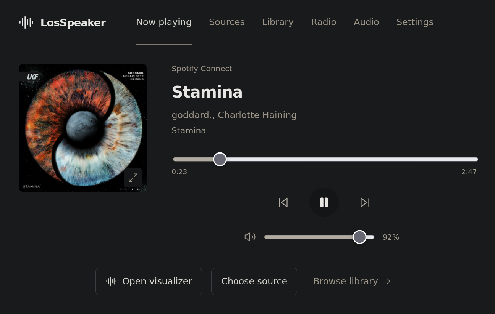

# LosSpeaker

Turn a Raspberry Pi into a music player and wireless audio receiver. Play your own library, stream from your phone, and control everything from a browser.



## Features

- **Wireless streaming** — AirPlay 2, Spotify Connect and Bluetooth.
- **Your music library** — local storage, USB drives and NAS shares, with folders, tags, playlists and queues.
- **Internet radio** — discover stations worldwide and save favourites.
- **Audio processing** — graphic and parametric EQ, plus CamillaDSP profiles for room correction and speaker crossovers.
- **Direct playback** — native-rate PCM and native/DoP DSD with compatible audio hardware.
- **Fullscreen visualizers** — three audio-reactive scenes with colour themes, song titles and artwork.

Spotify Connect requires Premium. High-resolution, DSD and multichannel playback depend on your audio hardware and configuration.

## Install

You’ll need a Raspberry Pi 4 or 5, Raspberry Pi OS Lite **64-bit Trixie**, and a USB DAC. Use a dedicated Pi; the installer configures its audio services and nginx.

1. Flash Raspberry Pi OS Lite, configure Wi-Fi or Ethernet, enable SSH, and boot the Pi.
2. Copy this repository to the Pi, connect your DAC, and run:

   ```sh
   sudo ./scripts/install.sh
   sudo reboot
   ```

3. Save the admin PIN printed by the installer.
4. Open `http://<hostname>.local`, unlock **Settings**, and select your audio output.
5. Choose **LosSpeaker** in Spotify or AirPlay, or enable Bluetooth pairing in **Settings** and connect your phone.

For your own music, add local, USB, SMB or NFS storage in **Settings**, then scan it into the library.

## Visualizers

Open **Now playing → Open visualizer** to choose between **Bloom**, **Warp** and **Terrain**. Each scene reacts to the live audio, with a persistent song and artwork overlay. Controls fade away while you listen.

Bookmark `http://<hostname>.local/#visualizer` to open it directly.

## Development

Requires Python 3.13+, [uv](https://docs.astral.sh/uv/), Node 20.19+ and npm.

```sh
./scripts/demo.sh
```

Open `http://127.0.0.1:8000`. The preview runs without audio hardware and does not play sound; its Settings PIN is `123456`.

See the [operations guide](docs/OPERATIONS.md) for storage, audio configuration, updates and troubleshooting. API documentation is available at `/docs` on the running player.
